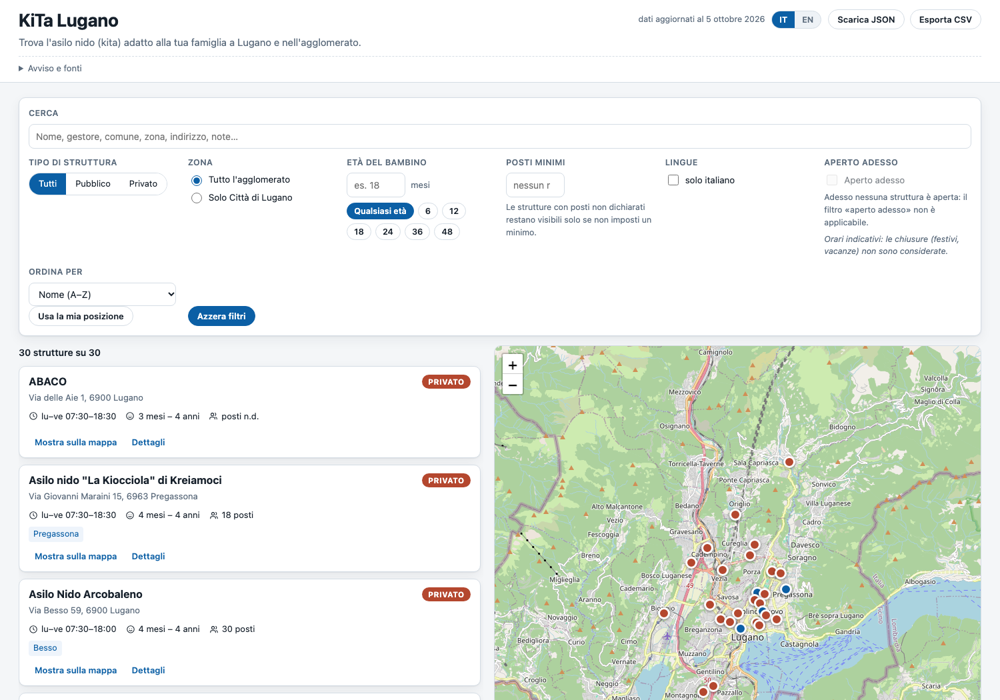

# KiTa Lugano 🧸🗺️

[](https://github.com/dovidio/kita-lugano/actions/workflows/validate.yml)
[](https://dovidio.github.io/kita-lugano/)
[](LICENSE)

A small, dependency-free project to **search day-care centres (*asili nido* / kita)
in Lugano** — with clean structured data and an interactive map.

**→ Live app: <https://dovidio.github.io/kita-lugano/>**

The dataset covers the **Città di Lugano and its agglomeration**: 30 facilities
(4 public, run by the municipal LIS institute, and 26 private), with address,
coordinates, capacity, age range, opening hours, closures, languages, contacts
and links back to the official sources.

No framework, no bundler, no npm dependencies: a JSON file, a Leaflet map, and a
~300-line Node server.



---

## Quick start

```bash
npm run serve          # → http://127.0.0.1:8787/
```

That's it — no install step, `node_modules` is not needed. Node ≥ 18 only (for the
optional server). The app is pure static files and can be served by anything pointed
at the repository root:

```bash
python3 -m http.server 8000    # → http://127.0.0.1:8000/
```

> The app fetches `data/kitas.json` with a *relative* URL, so it works both at a
> domain root and under a project path like `/kita-lugano/` on GitHub Pages.
> Opening `index.html` via `file://` will not work because of the browser's CORS
> rules for `fetch`.

## Hosting

GitHub Pages serves the `main` branch from the repository root (`.nojekyll` is
present, so there is no Jekyll processing — the files in the repo are the files
served). Pushing to `main` publishes; no build step, no deploy workflow.

---

## What the app does

**List + map side by side** (stacked with a List/Map toggle on mobile):

| Feature | Details |
|---|---|
| Free-text search | name, operator, municipality, neighbourhood, street, notes — accent- and case-insensitive |
| Filter by type | *pubblico* / *privato* |
| Filter by area | only the City of Lugano, or the whole agglomeration |
| Filter by child's age | in months (presets 6/12/18/24/36/48) — keeps the kitas that actually take that age |
| Filter by places | minimum number of places; "posti n.d." entries stay visible until a minimum is set |
| Filter by language | e.g. only Italian-speaking, or bilingual |
| "Open now" | against the current Europe/Zurich time and the recorded weekdays |
| Sorting | name, places (desc), or distance from your position (geolocation) |
| Detail view | every field, plus `tel:`/`mailto:` links, Google/Apple Maps links and the source references |
| Language | IT / EN interface toggle (the data itself stays in Italian) |
| Export | download the JSON, or the currently filtered set as CSV |

Every record shows how precise its map position is (`address`, `street`, or
`locality`), because the geocoding was derived from the addresses — see
[docs/SOURCES.md](docs/SOURCES.md).

The footer links straight to the issue forms, so anyone using the map can report a
wrong entry or propose a missing Kita without cloning anything.

---

## Structured data

The heart of the project is [`data/kitas.json`](data/kitas.json), validated by
[`data/kitas.schema.json`](data/kitas.schema.json) (JSON Schema 2020-12):

```jsonc
{
  "meta": {
    "data_version": "2026-10-05",
    "count": 30,
    "disclaimer": "…",
    "sources": [{ "id": "guida-2024", "label": "…", "url": "…", "publisher": "…", "retrieved": "…" }]
  },
  "kitas": [
    {
      "id": "nido-ronchetto",
      "name": "Nido d'infanzia Ronchetto",
      "type": "pubblico",                  // pubblico | privato
      "operator": "LIS — Lugano Istituti Sociali",
      "comune": "Lugano",
      "zona": "Molino Nuovo",
      "in_city_of_lugano": true,
      "address": { "street": "Via Ronchetto 16", "postal_code": "6900", "locality": "Lugano", "full": "Via Ronchetto 16, 6900 Lugano" },
      "geo": { "lat": 46.01955, "lon": 8.95639, "precision": "address", "geocoder": "swisstopo geo.admin.ch SearchServer" },
      "contact": { "phone": "+41 58 866 39 80", "email": "nidi.infanzia@lugano-lis.ch", "website": "https://www.lugano-lis.ch" },
      "capacity": 20,
      "age": { "min_months": 3, "max_months": 48, "label": "3 mesi – 3/4 anni" },
      "hours": { "label": "lu–ve 07:00–19:00", "open": "07:00", "close": "19:00", "days": ["mo","tu","we","th","fr"], "continuous": true },
      "closures": "2 settimane a Natale e 2 settimane a luglio/agosto",
      "languages": ["it"],
      "notes": "…",
      "sources": ["lugano-nidi-pubblici", "guida-2024", "lis"]
    }
  ]
}
```

Conventions worth knowing:

- **`null` means "not published by the source"**, never "zero" or a guess.
- `capacity: null` → shown as *posti n.d.*
- `geo: null` → the record still appears in the list, marked as having no position
- `hours.continuous: true` → open through lunch (no midday closing)
- `sources[]` are ids resolving to `meta.sources[]`

---

## JSON API

`npm run serve` also exposes the dataset for scripts and notebooks:

```bash
GET /api/kitas                     # all records
GET /api/kitas?q=pregassona
GET /api/kitas?type=privato&age_months=18&sort=capacity
GET /api/kitas?in_city_of_lugano=true&language=it&min_capacity=20
GET /api/kitas?lat=46.005&lon=8.951&sort=distance&max_distance_km=2
GET /api/kitas/nido-polis          # one record
GET /api/meta                      # dataset metadata
GET /healthz
```

Supported parameters: `q`, `type`, `comune` (repeatable), `in_city_of_lugano`,
`age_months`, `min_capacity`, `language`, `lat`/`lon`, `max_distance_km`,
`sort=name|capacity|distance`. Records gain a `distance_km` field when `lat`/`lon`
are given. The dataset is re-read from disk when the file changes, so no restart
is needed after editing the JSON.

The JSON API is local-only: GitHub Pages serves static files, so the published site
uses `data/kitas.json` directly.

---

## Scripts

```bash
npm run validate         # structural + domain validation of data/kitas.json
npm run check:i18n       # IT/EN dictionary parity + key references
npm run geocode          # (re)geocode from cache, write coordinates into the JSON
npm run geocode:refresh  # ignore the cache and query swisstopo again
npm run smoke            # boot the server and exercise API + assets end to end
npm run check            # validate + i18n + syntax-check the server
npm test                 # alias for smoke
```

`scripts/smoke.sh` boots the server on a scratch port and asserts the whole
contract: 30 records, the type/area/age/capacity/language/distance filters, single
record lookup and 404s, distance sorting, path-traversal blocking, and that
`index.html` references the vendored Leaflet bundle and the dataset. It exits
non-zero on the first failure and runs in CI.

`scripts/geocode.py` uses the **official Swiss geocoder** (swisstopo /
geo.admin.ch), caches every answer, and — this matters — **rejects implausible
matches**: the geocoder always returns its best guess, so the script requires all
distinctive street tokens to appear in the result and otherwise degrades the record
to street- or locality-level precision instead of silently pointing at the wrong road.

`scripts/validate.py` is a zero-dependency checker that enforces the schema
constraints plus cross-record invariants: unique ids, `meta.count` consistency,
every `sources[]` id resolving, Swiss phone format, coordinates inside Ticino,
coherent age ranges, opening hours that end after they start, and so on.

---

## Project layout

```
kita-lugano/
├── index.html                    # the app (served at / on GitHub Pages)
├── app.js                        # search, filters, sort, list ↔ map sync
├── i18n.js                       # IT/EN interface strings
├── styles.css
├── vendor/leaflet/               # Leaflet 1.9.4, vendored (works offline)
├── data/
│   ├── kitas.json                # the dataset (source of truth, hand-curated)
│   └── kitas.schema.json         # JSON Schema 2020-12
├── docs/
│   ├── SOURCES.md                # where every field comes from + geocoding notes
│   ├── FINANZIAMENTI.md          # cantonal subsidies, reimbursements, tax deductions
│   └── screenshot.png
├── scripts/
│   ├── geocode.py                # dataset → coordinates (swisstopo, cached, validated)
│   ├── validate.py               # dataset → errors/warnings
│   ├── check-i18n.mjs            # dictionary parity
│   └── smoke.sh                  # end-to-end test
├── server/
│   └── server.mjs                # dev server + JSON API, Node built-ins only
├── .github/
│   ├── workflows/validate.yml    # CI: validation + smoke test
│   ├── ISSUE_TEMPLATE/           # "add a facility" / "correct a detail" forms
│   └── pull_request_template.md
├── CONTRIBUTING.md
└── LICENSE
```

`data/raw/` (scraped snapshots and the geocoder cache) is intentionally **not
committed**: it contains third-party documents that are better linked than
redistributed. `npm run geocode` regenerates the cache locally.

---

## Contributing

Corrections are the most valuable contribution: a Kita that closed, changed its
hours, or opened somewhere new.

- **No Git needed** — use the issue forms:
  [add a facility](https://github.com/dovidio/kita-lugano/issues/new?template=add-kita.yml)
  or [correct a detail](https://github.com/dovidio/kita-lugano/issues/new?template=data-correction.yml).
- **Prefer a pull request?** Edit `data/kitas.json`, run `npm run geocode`,
  `npm run check` and `npm run smoke`, then open the PR. Full instructions, the
  JSON template and the review criteria are in [CONTRIBUTING.md](CONTRIBUTING.md).

Three rules apply to everything:

1. **Official sources only** — the City, LIS, the operator, a cantonal publication.
2. **Never guess** — a value you cannot source stays `null` (shown as "n.d.").
3. **Ids are permanent** — they appear in URLs and exports, so they are never renamed.

CI runs validation and the smoke test on every push and pull request.

---

## Sources

All data comes from official public sources — nothing is invented:

- [Città di Lugano — Nidi privati](https://www.lugano.ch/temi-servizi/sociale/famiglie-ragazzi/nidi-infanzia/nidi-privati/)
- [Città di Lugano — Nidi d'infanzia](https://www.lugano.ch/temi-servizi/sociale/famiglie-ragazzi/nidi-infanzia.html) (public/LIS)
- [Guida «Diventare mamma e papà» 2024](https://www.lugano.ch/dam/jcr:ea1efcca-e240-4c2f-8376-37c29611c615/Guida_DiventareMammaePapa_2024.pdf), section 2.2
- [LIS — Lugano Istituti Sociali](https://www.lugano-lis.ch)

Coordinates: [swisstopo geo.admin.ch](https://api3.geo.admin.ch). Map tiles:
© [OpenStreetMap](https://www.openstreetmap.org/copyright) contributors.

See [docs/SOURCES.md](docs/SOURCES.md) for the per-field mapping and the geocoding
notes.

## Scope and limitations

- **Nurseries only.** *Scuola dell'infanzia* (3–6 y, the school system), play
  groups and *famiglie diurne* are different services and are not included.
- **No prices.** Neither the City nor the private providers publish fixed fees:
  public fees are income-based, private ones are set per provider. See
  [docs/FINANZIAMENTI.md](docs/FINANZIAMENTI.md) for the cantonal subsidies that do
  apply, with amounts.
- **Opening hours are indicative.** Public-holiday and summer closures are only
  partially recorded, and the "open now" filter ignores them.
- **Capacity is the published maximum**, not current availability. Waiting lists
  are the norm — contact the facility early.
- **Positions are address-level**, not the exact entrance, and 4 of the 30 records
  are street- or municipality-level.
- Data reflects the official sources as retrieved on **2026-10-05** (guide edition
  2024). Always confirm details with the facility.

## License

Code: [MIT](LICENSE). Data: derived from publications of the Città di Lugano and
geocoded with swisstopo; please credit the City of Lugano and OpenStreetMap
contributors if you reuse it. Full attributions are in [NOTICE](NOTICE).
